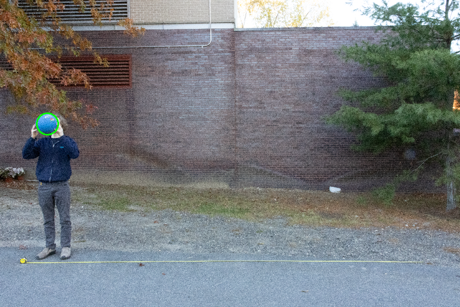
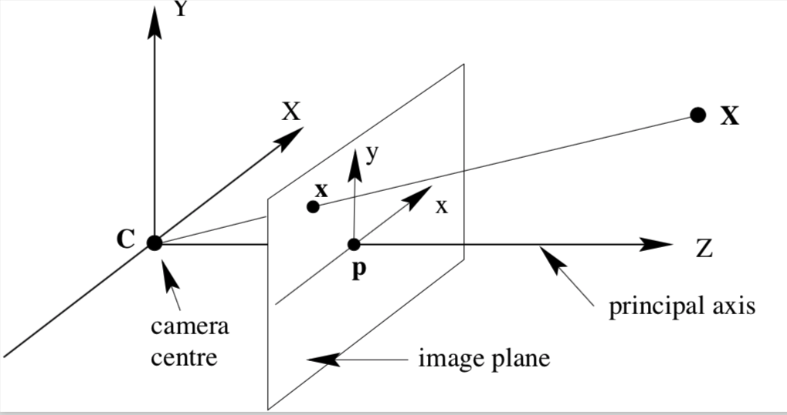

# Projectile Tracking

Author Names: Austin Woolf and Mik Miller

For Olin ENGR3590 Computational Introduction to Robotics

# Overview

We wrote a set of algorithms that read a photo of a ball, find where the ball is in the image, and project that point into 3D space. We used OpenCV for the camera calibration, color masking, and circle detection. We implemented a pair of ROS2 nodes to carry out these calculations and publish the results.

## Goals

Through this project we wanted to:

* Practice planning out work for the team to be efficient with time, work asynchronously, and minimize issues with version control.  
* Get experience translating from 2D points in images to 3D points in space.  
* Get more familiar with ROS2 tools like rviz and rqt.  
* Get familiar with implementing computer vision and integrating it with previous knowledge.

## Use Cases

While our project is specially designed to detect a thrown ball, our framework could be used for several applications in robotics, particularly robots in unstructured environments. Because these environments may not have maps or contain unpredictable obstacles, robots typically use onboard sensors to interpret their surroundings. Our framework could be an approach for local state estimation as well as aid in navigation and obstacle avoidance. Additionally, working in 3D space, which our model does, provides better robustness and handling for robots that are not on the ground.

# Methodology

## System

While this project did not need to be implemented in ROS2, we wanted to get more familiar with it and its tools, so we decided to implement our project as a pair of ROS2 nodes. The first node, `ball_detector`, reads an image and finds the ball in it. It detects the ball as a circle in the image, and it publishes the position and radius of this circle to be read by our second node, `position_calculator`. This node takes in the position and radius, each measured in pixels, as well as the pixel width and height of the image. It uses the radius of the circle to determine the distance from the camera’s focal point to the ball, which it then uses to project the 2D position of the ball into 3D space.

## Algorithms

To take in the image, we use OpenCV. It reads a png file and stores the pixel data as a numpy n-dimensional array (ndarray). This image, taken straight from the camera, is naturally slightly distorted. For our projection to work properly, we assume that all straight lines in the real world appear as straight in the image, but this is not necessarily the case. To correct for this, we use OpenCV’s `calibrateCamera`, and `undistort` functions, to calculate a calibration matrix, and to apply it to each image respectively. To calculate the calibration matrix, we use a set of photos we took of a checkerboard pattern using our camera. Because of the size of our photos, this process takes several minutes. Since we don’t want to wait this long to find the position of the ball, and since this operation only needs to be done once for the camera, we have a separate program that finds the calibration matrix. It writes the matrix to a YAML file to be read by the ball detector node when it needs to calibrate the photo.

Once the image is calibrated we detect the ball. The first step of this process is to isolate the ball in the image based on color. The ball is mostly a solid color but it has highlights and shadows. If we were to define a range of values for the red, blue, and green color channels of the image, we wouldn’t be able to narrow this range down as much as we’d like, because the shadows and highlights widen the range of all three channels. So, to account for this, we convert to hue, saturation, value (HSV) colorspace using OpenCV’s `cvtColor` function. This way, we can have a tight range of hues, to isolate the blue of the ball, and a wider range for saturation and value, to account for the lighting. Once we found a good HSV range for our ball we wrote it to a YAML file to be read by the ball detector node. With these values, it uses OpenCV’s `inRange` function to make a black and white image where the ball is white and everything else is black.

  
(Figure 1) The position and radius of the ball is found using HoughCircles.

Next, we used a built in OpenCV function, `HoughCircles`, which applies the Hough Circle Transform to an image. This function outputs the x and y center position and radius of each detected circle. Our implementation is based on this OpenCV documentation, [https\://docs.opencv.org/4.13.0/da/d53/tutorial_py_houghcircles.html](https://docs.opencv.org/4.13.0/da/d53/tutorial_py_houghcircles.html) . `Hough Circles` has several input parameters which include input image and Hough detection method. It also has parameters that affect the sensitivity of the detection such as `dp`, `minDist`, `param1`, `param2`, `minRadius`, and `maxRadius`. Below is an explanation of each as well as our design choices.

- `image` (input image): Our black and white image result  
- `method` (Open CV Hough detection method): `Hough Circles` supports two different methods which include **HOUGH\_GRADIENT**, which focuses on how many pixels at a time are grouped together before a circle is determined, and **HOUGH\_GRADIENT\_ALT**, focusing on circle perfectness. We tested both of these methods and found that **HOUGH\_GRADIENT\_ALT** gave us the best result.  
- `dp` (inverse ratio of the accumulator resolution to the image resolution): Accumulator resolution affects the size of pixel grid used to determine circle locations. Because the OpenCV documentation recommended to use a starting ratio of **1.5** for **HOUGH\_GRADIENT\_ALT**, this is what we implemented.  
- `minDist` (minimum distance between circle centers): Because we are only detecting one ball of the scope of this project, we set `minDist` to be slightly larger than the image dimensions. That way, the algorithm only detects one circle. However, because of this, the algorithm picks the strongest circle which often was not the ball. To troubleshoot this, we set `minDist` temporarily to 1 to figure out how strong the algorithm determined our ball was.  
- `param1` (Scharr derivatives edge detection threshold):  
- `param2` (circle “perfectness”): This parameter is between 0 and 1 where 1 is a perfect circle. We found that setting this too 0.6 yielded the best results.   
- `minRadius` (minimum radius of circle detected): Because this parameter tells the algorithm to only detect circles larger than this value and we wanted to fully tune it, we set this value to 0\. This is an OpenCV specific setting that allows the minimum radius of the circles drawn to be unlimited.  
- `maxRadius` (maximum radius of circle detected): Similarly to `minRadius`, we set this value to 0\.

To convert the 2D position and radius of the ball in the image, measured in pixels, to the 3D position of the ball in the world, measured in feet, we first find the z axis distance from the camera’s focal point to the ball. We took a set of photos with constant positions in the x and y directions (right and up from the camera’s perspective), with evenly incremented positions on the z axis (towards the camera). We then found the radius of the ball, in pixels, in each photo and used this data to make a calibration curve that converts from circle radius in pixels to ball z axis position in feet. This curve is defined by a constant, which we calculated, divided by the radius of the circle.  

  
(Figure 2\) The pinhole camera model describes how objects in 3D space are projected onto the image sensor of an ideal pinhole camera. This assumes that the aperture of the camera is a single point, and that there is no lens to distort the image in any way. No real camera has an infinitesimally small aperture so some parts of the image will be slightly blurred, and the lens of the camera slightly distorts the image but we account for this with our camera calibration.

x \= X \* f / Z  
y \= Y \* f / Z  
(Equation 1\) With an ideal pinhole camera, a point in 3D space (X, Y, Z) will be projected onto the image sensor such that the position of the point in the image (x, y) is proportional to the real x/y position and the focal length (f), and inversely proportional to the z position.

X \= Z \* x / f  
Y \= Z \* y / f  
(Equation 2\) This can be rearranged to get the 3D X/Y position from the 2D x/y position, focal length, and 3D z position.

Note that the variables in Equations 1 and 2 use the same units. Our 2D point is measured in pixels, however, our focal length is measured in millimeters, and our distances are measured in feet. To account for this we used the known size of the camera’s image sensor in both millimeters and pixels. By multiplying the focal length term in the equation by the ratio between the sensor width (w) in pixels and it in millimeters, we keep its physical meaning but convert from millimeters, which we know, to pixels, which we need. This means that in our final equation, Equation 3, the units of the two terms in pixels, x/y and f, cancel out, leaving both sides of the equation in feet, which is how we want our output to be.

X(feet) \= Z(feet) \* x(pixels) \* (w(mm) / w(pixels)) / f(mm)  
Y(feet) \= Z(feet) \* y(pixels) \* (w(mm) / w(pixels)) / f(mm)  
(Equation 3\) The equation we use to calculate x and y position in 3D space from the z position, radius, and what we know about the camera's physical properties.

## Design Decisions

Since we decided to work in ROS, we initially felt that it would be appropriate to take in camera feed from a ROS topic. This would frame the project as if we were taking it in from some unknown source which we liked because of its modularity. We wrote a node to routinely publish images to a topic that the ball detector would read from. Unfortunately, when we finally got this to work, the images we received using rqt were much noisier than the ones we published and they came through at a much slower and inconsistent rate than we had expected. We could have decided to downscale the images we use, which are each 60,000kB. However, we didn’t want to lose quality, and since the images from the topic were coming through noisy anyway, we decided to pivot to having the ball detector read one image. Below are some of our key decision designs for each of the functions we implemented in `ball_detector.py` and `position_calculator.py`:

- `def load_images`: Converts images to an OpenCV readable format. Because we were initially going to load a series of images, this function is set up to store each loaded image in a list. Even though we needed to pivot, we did not modify this function since it still works and allows for the code to be modular if we were to implement this in the future  
- `def undistort_image`: Camera images have distortions that make post-processing and detection difficult. This function applies a calibration matrix to each incoming image to account for these distortions and stores each image in a list  
- `def detect ball`: This function applies a mask to isolate the ball and then applies the Hough Circle Transform algorithm. This function then stores the x, y, and radius of each detected circle as well as the image dimensions which are used by `position_calculator.py`. The images are also resized since the original file sizes would take hours to process. This function was tested in a file called `example_ball_detection.py`.  
- `def calculate_position`: unpacks msg from `ball_detector.py` and publishes 3d position. This function also uses a calibration curve to calculate the distance based on the differences in ball radius size. 

# Challenges and Limitations

In its current state our program requires multiple seconds to run. If we were to convert the ball detector node to take in a live stream of data, it would not be able to work at runtime. Most applications of this program require live position calculations which our program would not be able to provide.

To appropriately scope this project we decided to only use one camera to calculate the position of the ball, using the radius of the ball in the image as an indicator of distance. Our camera resolution and noise don’t greatly hinder the accuracy of the x and y position calculations. However, the radius measurements, which are smaller than the x and y position measurements, are by extension more noisy. This means the z axis position calculations we make are noisier as well, and since z is used to calculate x and y, using one camera instead of two, significantly reduces our accuracy.

The program in its current form is a proof of concept. Because of the time frame of this project, we prioritized getting a functional program over one that was modular and robust. This means it only works on images taken by the same camera, with the same settings, in similar lighting, and most notably, of the same ball.

## Next Steps

If we had more time on this project the first update we would make to it would be to establish better input and output interfaces. In its current state the program takes in one image, pasted into the repository, and publishes a point to a ROS topic. Ideally it would take in images from a ROS topic over time, and publish the positions of the ball in a better defined coordinate frame. We would do this because most use cases require inputting video feed and the current coordinate frame we use makes sense for the application but displays differently than we would want in rviz.  
Additionally, we could implement a function that estimates the trajectory of the ball using a Kalman filter. A Kalman filter is particularly helpful for this because it continuously handles detection updates and reduces measurement noise as opposed to an estimation from a fixed position.

# Takeaways

Through this project, we gained experience working with OpenCV and ROS2. We learned the basics of image processing with OpenCV and got to spend more time working in ROS2 making us more confident using it. We practiced working on separate sections of code with limited interfaces to maximize the work we could do asynchronously. We did this through ROS, which is well suited to this type of architecture but we found that for the purposes of this project it was not very helpful. We wanted to use it so we could visualize intermediate steps through rviz and rqt but weren’t able to do much with either. Although we got experience using these tools, which we set out to do, we found that displaying images through OpenCV’s `imshow` function was much more convenient.

# How to Run

1. If you haven’t already, set up a ROS2 Jazzy workspace using the [CompRobo instructions](https://comprobo26.github.io/How%20to/setup_your_environment).  
2. Install OpenCV by running `pip install opencv-python` in your terminal.  
3. Clone this repository into your `ros2_ws/src` directory.  
4. Create a directory inside of your `ros2_ws/src/Computer-Vision-Projectile-Tracking/projectile_tracking` directory named `photos`.  
5. Download an image from our [Google Drive](https://drive.google.com/drive/folders/1N3-gvEdkvS4225ycjw5OndmiJmaaT36y), use one from photos or videos to get one with a ball in it.  
6. Rename the image to `input.png` and move it to the `photos` directory you created.  
7. Open three terminals in your `ros2_ws` directory.  
8. In one of these terminals run the commands `run colcon build \--symlink-install` and `source ./install/setup.bash`.  
9. Run the following commands, in order, one in each of your `ros2_ws` terminals: `ros2 topic echo \ball_pos geometry_msgs/msg/PointStamped`, `ros2 run projectile_tracking position_calculator`, `ros2 run projectile_tracking ball_detector`.  
10. Read the output of the terminal that you ran `ros2 topic echo \ball_pos` in. This includes the x, y, z position of the ball measured in feet. Its frame is defined with the origin at the focal point of the camera, which lines up with the center of the image, \+x being to the right, \+y being up, and \+z being forward.  
11. Use ctrl+c in all your terminals to shutdown the nodes and stop reading from the ball position topic.
